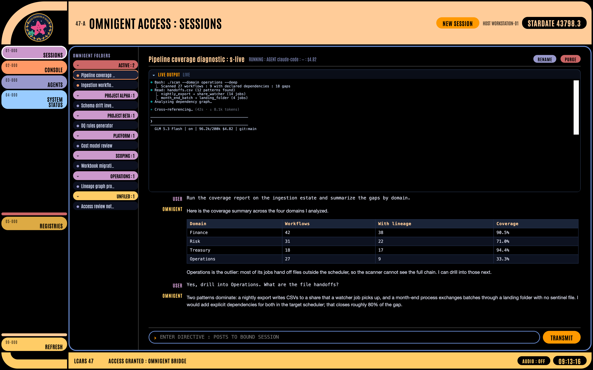

# LCARS for Omnigent

A Star Trek LCARS-styled skin for [Omnigent](https://github.com/omnigent-ai/omnigent), the open-source agent authoring and runtime framework. Sessions, transcripts, live terminal output, and agent prompts render through an Okuda-style panel: angled color blocks, oversized type, and a ticking stardate.

**This is a skin, nothing more.** It adds no functionality to Omnigent. Every capability here (sessions, streaming, terminal attach, runners, models, permissions) comes from Omnigent itself, through its local server API. For everything the runtime can do, read the official Omnigent documentation and README at [github.com/omnigent-ai/omnigent](https://github.com/omnigent-ai/omnigent).



## Pieces

- `app/` : single-file web UI (LCARS panel, xterm.js live output, vendored assets)
- `server.py` : thin HTTP/WebSocket proxy, Python standard library only, bridging the UI to a local Omnigent server
- `macapp/` : optional native macOS shell (Swift + WKWebView) so it runs as a real app; `./macapp/build.sh` builds it
- `mockup/` : the original static mock, kept for reference

## Run

```bash
python3 server.py        # http://127.0.0.1:6768, expects a local Omnigent server on 6767
```

## Status

Work in progress, built for fun. Expect rough edges.

**Personal project.** Not an official or supported Databricks project, and not affiliated with or endorsed by any Star Trek rights holder. LCARS imagery here is fan art.
