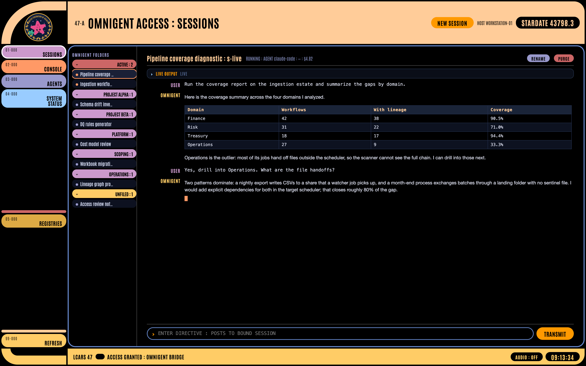
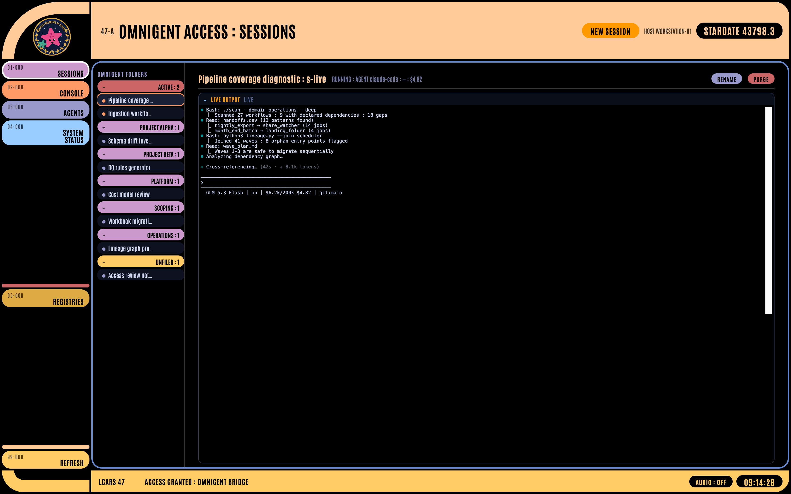
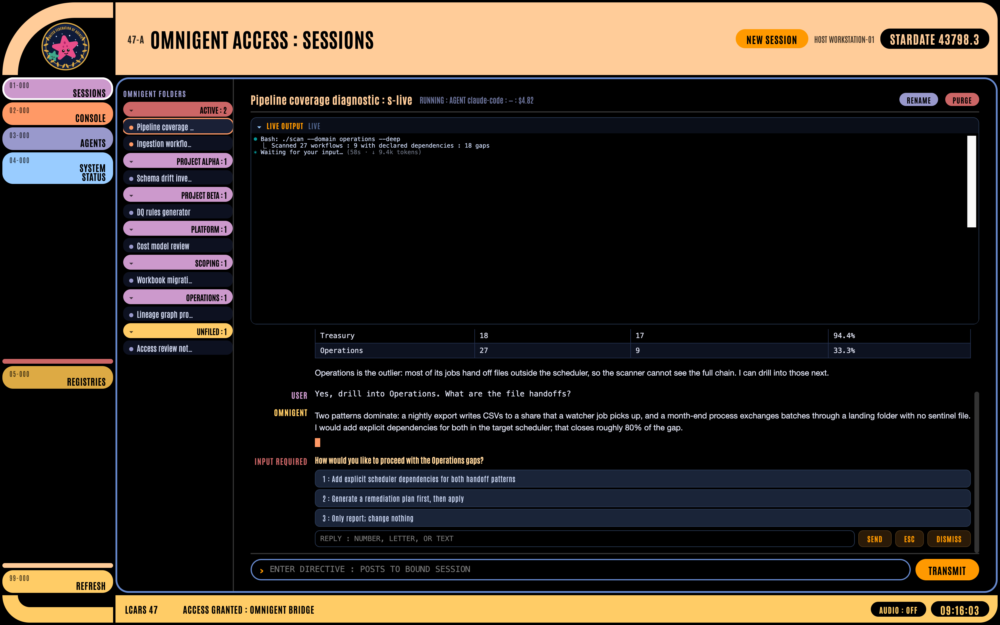
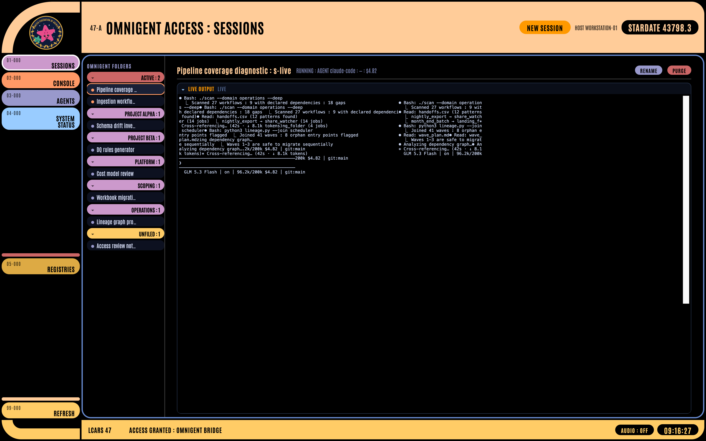

# ENGAGE: I Gave My AI Agents a Star Trek Interface

### An LCARS skin for Omnigent, the open-source agent runtime, and what it taught me about the computers we actually want

I have loved [Star Trek: The Next Generation](https://en.wikipedia.org/wiki/Star_Trek:_The_Next_Generation) for most of my life. Not the phasers. The computer. The one where you say "tea, Earl Grey, hot" and the ship understands, executes, and reports back without ever making you feel like a systems operator. For a lot of us in software, that bridge-computer is the original promise of what we now, less romantically, call agents.

So when I found myself running my daily work through [Omnigent](https://github.com/omnigent-ai/omnigent) in a plain terminal, I did the only reasonable thing: I built [LCARS](https://en.wikipedia.org/wiki/LCARS) around it.

## The skin thing is not vanity

In 1989, [After Dark](https://en.wikipedia.org/wiki/After_Dark_(software)) put flying toasters on millions of screens, and something clicked: the computer's face was negotiable. That idea ran forward through the [Windows 95 Plus!](https://en.wikipedia.org/wiki/Microsoft_Plus!) desktop themes, [WindowBlinds](https://en.wikipedia.org/wiki/WindowBlinds), and the enormous [Winamp](https://en.wikipedia.org/wiki/Winamp) skin archive, where a whole generation learned that software identity lives in its chrome as much as in its features. A skin is not decoration. It is a claim about what the machine is for.

LCARS, the Library Computer Access/Retrieval System, is the fictional operating system of Starfleet, designed on screen by [Michael Okuda](https://en.wikipedia.org/wiki/Okudagram): bold angled color blocks, oversized type, stardates ticking in the corner, and an interface that assumes the operator is brilliant and busy. It has outlived most real UI frameworks, and it is the perfect skin for an agent runtime, because LCARS was always a front end for a computer that does things on your behalf.

## What Omnigent actually is

This is the part worth underscoring: Omnigent is open source. Apache 2.0, on [GitHub](https://github.com/omnigent-ai/omnigent), installable from [PyPI](https://pypi.org/project/omnigent/) or Homebrew, originally built at Databricks. Its pitch, in its own words: declarative agent authoring and a runtime framework. You author an agent as a spec, and the runtime runs it across interchangeable harnesses. The same session can ride Claude Code, Codex, OpenAI Agents, and others, while a local server exposes sessions, streaming transcripts, terminals, and runners over a clean HTTP and WebSocket API.

If you know [Databricks Genie](https://www.databricks.com/products/genie), the product where you ask questions of your data in plain language, you already know the shape of this idea. Genie is the specialized case: a conversation with your warehouse. Omnigent generalizes it: a conversation with your entire working environment, files, terminals, and tools, governed and inspectable. Genie gives you the analyst's answer. Omnigent gives you the analyst, the terminal they run it in, and the receipt for every command. My LCARS build is a front end for that, the way the Enterprise bridge panel is a front end for the ship's computer: the same lineage of "talk to the machine," one level up.

Full disclosure: I work at Databricks. This is a personal side project on the open-source project, not a product announcement.

## What the interface does

The build, very much work in progress, lives in a [small repo](https://github.com/douglas-spadotto_data/lcars-omnigent). Three pieces:

- A single-file web UI: the LCARS panel with the orange-and-lavender geometry, a collapsible nav rail, project folders for sessions, and a "Federation of Agents" badge I drew as an homage to the UFP seal (there is a mockup folder in the repo if you want to see how far it drifted from the first sketch).
- A thin [Python](https://www.python.org) proxy, standard library only, bridging the UI to the local Omnigent server.
- A native macOS shell: about two hundred lines of [Swift](https://www.swift.org) around a [WKWebView](https://developer.apple.com/documentation/webkit/wkwebview), so the whole thing is a real app in the Dock and in cmd-tab, with its own badge icon, not a browser tab lost among forty others.

The main screen shows the conversation: you and the agent, nothing else. Reasoning steps and tool executions live in a separate LIVE OUTPUT panel, which renders the agent's actual terminal through [xterm.js](https://xtermjs.org/). Click any past message and that panel reopens the working stream for that turn, so the history of how an answer was produced stays inspectable without polluting the prose.

Voice comes through [Superwhisper](https://superwhisper.com): I dictate into the directive field and it posts to the session like typed input. "Computer" is, at this point, implied.

## Two details I did not expect

Both of these surfaced within an hour of daily use, and both are the kind of thing only appears when your UI is honest about what the machine is doing.

The live panel attaches read-only to the same [tmux](https://github.com/tmux/tmux) pane the agent's CLI runs in, via tmux control mode. The catch: a read-only viewer attaches with ignore-size, meaning it cannot reflow the pane. The first time I rendered it, the text came out doubled and overlapping, because my terminal is 190 columns wide and the panel tried to draw at its own narrower width, so every cursor-positioning escape landed on the wrong row. The fix was to ask tmux for the pane's true geometry and render xterm at exactly that grid. The result is an interface that shows my agent's terminal precisely as the CLI paints it, colors and spinner included, streaming live. I found the bug by watching the interface display the agent that was building the interface, garbling itself in real time. Debugging has rarely felt so meta.

The other one is the INPUT REQUIRED card. When the agent stops and asks a question in the terminal, the interface scrapes the visible terminal buffer, detects the prompt, and surfaces it as a card in the main window where I can click an option, or type "2", or a letter, or a full sentence, which gets injected back into the pane as keystrokes. Getting that detection right took three guards: the menu cursor must sit on a numbered option, two consecutive scans must agree, and, the important one, the pane must have been silent for a few seconds. A working agent repaints its spinner every second, and its diffs and commit messages contain plenty of menu-lookalike text. Silence is the difference between "the machine is showing me a menu" and "the machine is waiting at one."

And yes, the header shows a live [stardate](https://en.wikipedia.org/wiki/Stardate), computed with the TNG convention: one thousand units per year, epoch 2323, today projected 340 years forward so it lands in the five-digit range Picard would recognize.

## The part that made it worth it

The interface was largely built by the agent it now wraps, while I watched its terminal through the very panel being built. Early on that created a strange, wonderful feedback loop: the interface showed its own construction, bugs included, and my favorite user report, "the live output pollutes the session," was diagnosed by watching the bug happen in the panel that was reporting it.

Smart assistants have been five years away for forty years. What changed recently is not that agents got smarter, but that they became inspectable: real runtimes with session APIs, transcripts, terminal access, and governance, running locally, in the open, under an Apache license. Once a runtime has a real API, a skin is just an evening of work. Mine is unfinished, occasionally stubborn, and an absolute joy to leave fullscreen on my second monitor, stardate ticking, while I talk to the ship.

Engage.
